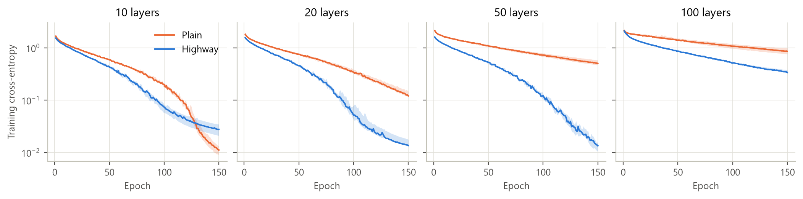
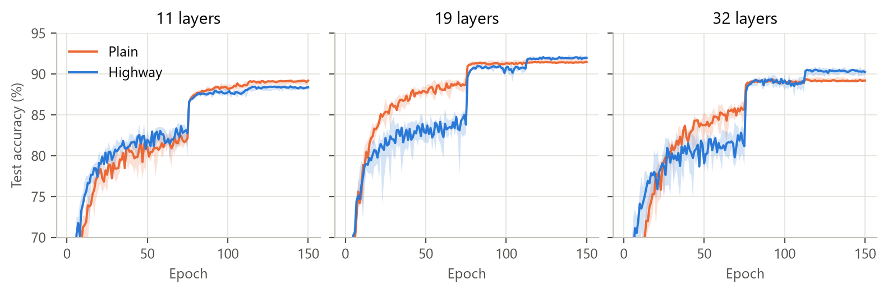
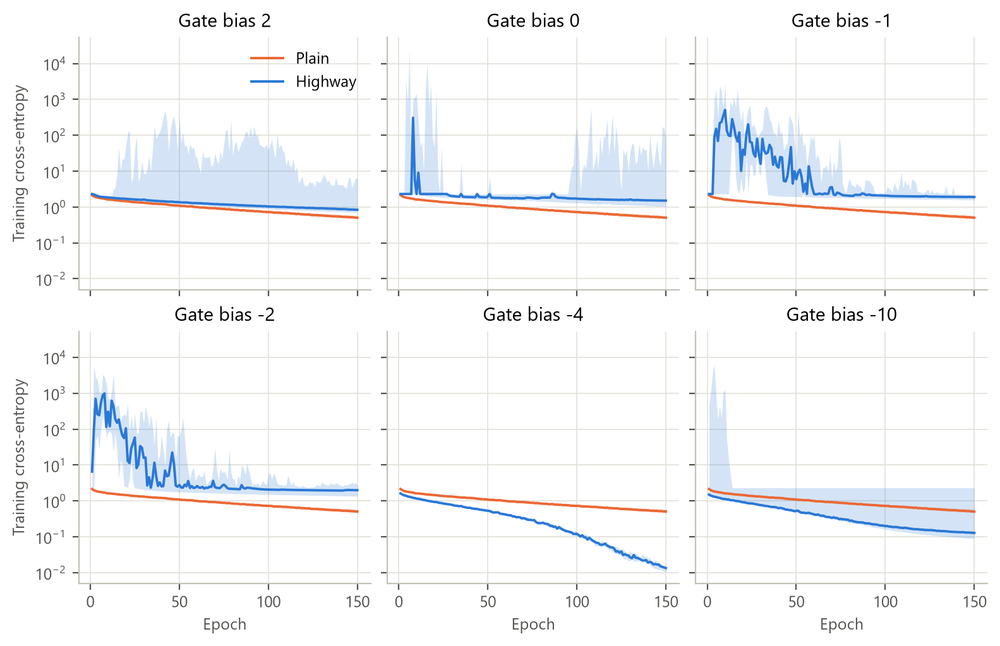
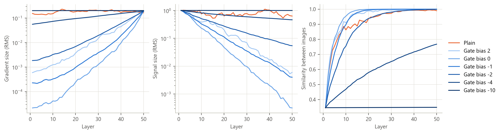
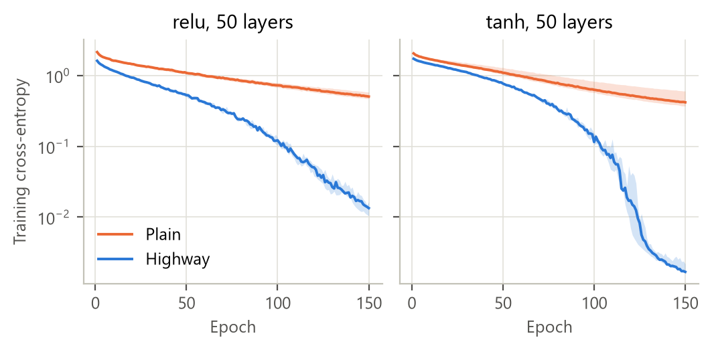
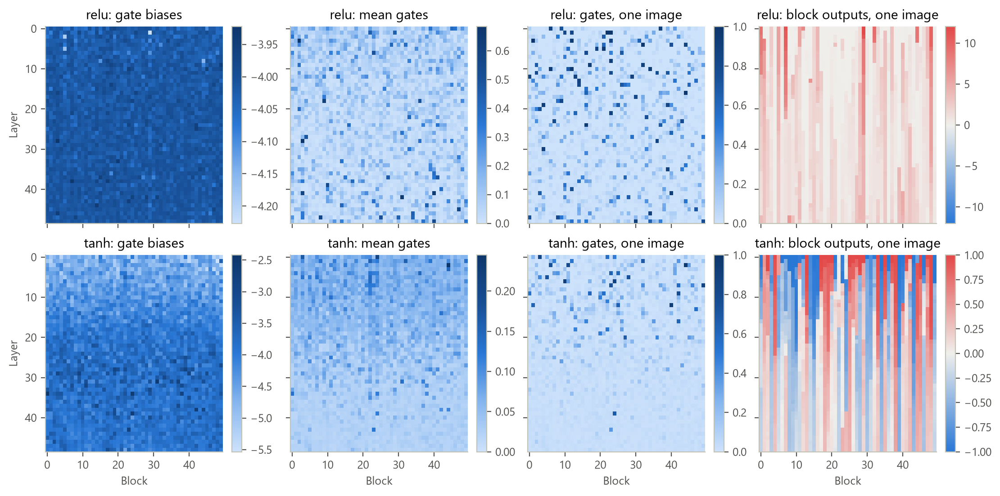
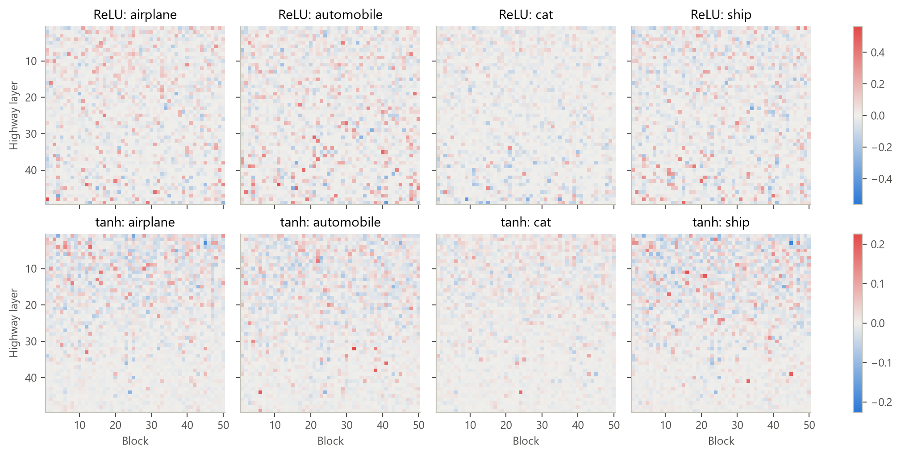
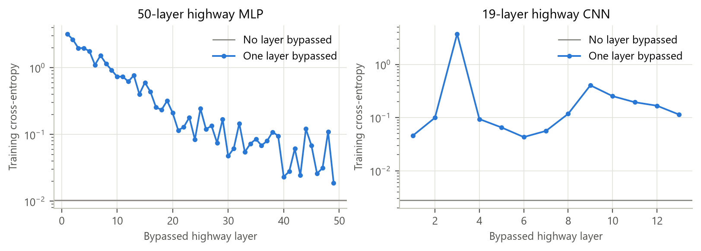

# Highway Networks on CIFAR-10

A PyTorch implementation of highway networks ([Srivastava, Greff & Schmidhuber, 2015](https://arxiv.org/abs/1505.00387)), trained on CIFAR-10 and compared with plain networks of the same size. It also tests how much the gate bias and the activation function matter, and looks inside trained networks to see what the gates do.

Everything was trained on one PC (RTX 4060, Ryzen 7 9700X): about 29 GPU hours for the convolutional networks and 60 CPU-thread hours for the fully connected ones. The weights are saved, so every table and figure can be recomputed on a laptop without training ([Running it](#running-it)).

## Results in brief

- **Highway MLPs keep training as they get deeper; plain ones don't.** After 150 epochs, the plain MLP's training loss grows from 0.011 at 10 layers to 0.50 at 50 and 0.86 at 100 layers, while the highway MLP stays at 0.013–0.028 up to 50 layers. At 100 layers the ReLU highway network slows down too (0.34), but a tanh one trains as well as at 50 layers (0.0016 against 0.0017), as in the paper. This is about optimization only: without data augmentation, all of these MLPs overfit and land at 38–45% test accuracy.
- **Convolutional highway networks reach the paper's accuracy.** 19 layers: 92.13% (best of five seeds; mean 91.98 ± 0.12) against the paper's 92.24%. 32 layers: 90.62% (90.21 ± 0.27) against 90.34%. On average they beat plain CNNs of the same size by 0.5 points at 19 layers and 1.0 at 32, and lose by 0.7 at 11.
- **The plain CNNs train fine too.** With ReLU and He initialization they train directly to the accuracy that FitNets reached only with a teacher network (on average 89.04% vs. 89.01% at 11 layers, and 91.51% vs. 91.61% at 19). What the gates add at these depths is a higher usable learning rate: the deep highway CNNs train at 0.1, a rate that leaves their plain partners stuck at chance.
- **With ReLU, the gate bias must start strongly negative.** At 50 layers, a bias of −4 trains in every seed (loss 0.013), −10 in three of five, and every bias from −2 to +2 ends worse than the plain network. A half-open gate averages its input with a partly unrelated signal, which shrinks the signal by 15% per layer: to 3 × 10⁻⁴ of its size after 49 layers. With tanh, −2 also works (0.031).
- **Plain ReLU networks aren't slowed by vanishing gradients here.** He initialization keeps their gradients the same size in every layer. What goes wrong is that by layer 50 every image looks almost the same to the network (cosine similarity 0.99).
- **Trained gates are selective, and every layer is used.** For one image only 1–5% of the gates are open, but different images open different gates. The tanh network reproduces the paper's pattern of gate biases rising with depth. Bypassing any single layer raises the training loss.

## How a highway network works

This section follows the paper and its longer follow-up by the same authors, [Training Very Deep Networks](https://arxiv.org/abs/1507.06228). Where both papers cover a point, they use the same equation and section numbers.

A **plain layer** computes `y = H(x, W_H)` (Eq. 1), where H is usually an affine map followed by a nonlinearity. According to the paper, SGD stalls at the start of training a deep plain network unless the weights are initialized so that signals keep their size on the way forward and back, and the right initialization depends on the exact form of H (Section 2.2).

A **highway layer** lets every unit decide, for every input, how much of its output is the transformed input and how much is the input itself. In general it has two gates, the *transform gate* T and the *carry gate* C (Eq. 2):

```
y = H(x, W_H) · T(x, W_T) + x · C(x, W_C)
```

Both papers use the simplest choice, C = 1 − T, which gives the standard highway layer (Eq. 3, where `·` multiplies element by element):

```
y = H(x, W_H) · T(x, W_T) + x · (1 − T(x, W_T))
```

Drawn as a diagram, with g for the activation function:

```
     ┌──────────────────────────────► × ──────────┐
     │                                ▲ 1 − T     ▼
x ───┼──► T = σ(W_T x + b_T) ─────────┤          (+) ───► y
     │                                ▼ T         ▲
     └──► H = g(W_H x + b_H) ───────► × ──────────┘
```

H is an ordinary layer, here an affine map followed by ReLU or tanh. The gate is a second layer of the same size, with its own weights and a sigmoid, so every gate value lies between 0 and 1 (Section 2.2):

```
T(x) = σ(W_T x + b_T)
```

**Blocks.** The papers call the units of a highway layer *blocks* (Section 2). Block i computes a *block state* H_i(x) and a gate value T_i(x), and outputs `y_i = H_i(x) · T_i(x) + x_i · (1 − T_i(x))`: a mix of its own transformed value and the matching input value x_i, weighted anew for every input. With two weight matrices, W_H and W_T, a highway layer has twice the parameters of a plain layer of the same width.

**Between copying and transforming.** A shut gate (T = 0) makes the layer copy its input, so its Jacobian is the identity matrix; a fully open gate (T = 1) makes it a plain layer (Eqs. 4 and 5):

```
y = x,       dy/dx = I         if T(x) = 0
y = H(x),    dy/dx = H′(x)     if T(x) = 1
```

A sigmoid never reaches 0 or 1 exactly, so every block works in between, and training can move it smoothly from one behavior to the other. Where gates are nearly shut, a signal can cross many layers almost unchanged: the papers call such paths *information highways*. The gating is inspired by LSTM recurrent networks ([Hochreiter & Schmidhuber, 1997](https://doi.org/10.1162/neco.1997.9.8.1735)), whose gates let information pass across many time steps as highway gates let it pass across many layers.

**The backward pass.** For a gradient `dy` arriving at the output, the follow-up gives the gradients of the highway operation itself (Appendix A, Eq. 9):

```
dH = T · dy        dT = (H − x) · dy        dx = (1 − T) · dy
```

From H and T, backpropagation continues into their weights and on to x, since both depend on x too. These three products explain several results below. A shut gate passes the gradient straight through to x, however deep the network, but it also hides the gradient from H, which then learns slowly. And a gate only learns where its two candidates differ: where H(x) = x, its gradient is zero.

**Starting with the gates nearly shut.** The gate bias b_T starts negative: the paper suggests values such as −1 or −3, and the follow-up −1, −2 and −3 for convolutional networks of depth about 10, 20 and 30 (Section 2.2). Every gate then starts mostly shut, so a deep network starts out copying, like a much shallower one, and training opens the gates where transforming helps. The papers found this enough for very deep networks to train, for different activation functions and zero-mean initial weights of H. Unlike a plain network's initialization, it doesn't depend on the form of H, and the follow-up reports that SGD didn't stall even with more than 1,000 layers. The idea comes from LSTMs, whose gates also get initial biases, to help bridge long time lags early in learning (Gers et al., 1999).

**Changing the width.** Eq. 3 needs x, y, H(x) and T(x) to have the same shape. To change the size of the representation, x could be sub-sampled or zero-padded, but both papers use a plain layer instead and stack highway layers after it (Section 2.1). So does this project: the first layer of every MLP, and every convolution that changes the channel count, is a plain layer.

**Convolutional highway layers** compute both H and T with convolutions, with weight sharing and local receptive fields (Section 2.1). The follow-up gives H and T receptive fields of the same size, and both papers zero-pad them, so that the block states and the gates keep the input's size. The gate then works per channel and per position: every value of every feature map has its own gate.

**Residual networks** ([He et al., 2016](https://arxiv.org/abs/1512.03385)), which came later, drop the gates: `y = H(x) + x`. In terms of Eq. 2 both gates stay fully open, which the coupled form C = 1 − T cannot express.

In [models.py](models.py) the highway layer is one small module. Eq. 3 only multiplies and adds element by element, so `make_layer` can build a linear layer for MLPs or a zero-padded convolution for CNNs:

```python
class Highway(nn.Module):
    def __init__(self, make_layer, activation, gate_bias):
        super().__init__()
        self.transform = nn.Sequential(make_layer(), activation())    # H
        self.gate = nn.Sequential(make_layer(), nn.Sigmoid())          # T
        nn.init.constant_(self.gate[0].bias, gate_bias)                # negative: starts nearly closed

    def forward(self, x):
        t = self.gate(x)
        return self.transform(x) * t + x * (1 - t)
```

## What is in this repository

| File | Lines | Contents |
|---|---|---|
| [models.py](models.py) | 96 | The highway layer, MLP and CNN builders with their plain partners |
| [data.py](data.py) | 51 | CIFAR-10 as tensors on the training device, per-image contrast normalization, augmentation |
| [train.py](train.py) | 119 | One training run: SGD, learning-rate schedule, checkpoints every 10 epochs, resume |
| [experiments.py](experiments.py) | 93 | The experiments as data, the learning-rate search, a parallel runner |
| [analyze.py](analyze.py) | 289 | The results table and every figure, from saved results and weights |
| `results/` | | One JSON file per run (configuration and per-epoch metrics), and [summary.md](results/summary.md) |
| `figures/` | | The figures in this README |
| `checkpoints/` | | The weights of every final run, 305 MB (not in git) |

## Setup shared by all experiments

- **Data.** CIFAR-10: 50,000 training and 10,000 test images, each normalized to zero mean and unit standard deviation (global contrast normalization). The CNNs are trained with random ±4-pixel translations and mirroring. The MLPs get no augmentation, because they are an optimization study.
- **Plain partners.** Every highway network is compared with a plain network of about the same size. MLPs follow the paper: 50 units per highway layer and 71 per plain layer, so both have about 5,100 parameters per layer. A plain CNN gets 1.18–1.37 times more channels, which matches the highway CNN's parameter count to within 1%.
- **Training.** SGD with momentum 0.9, batch size 128, He initialization for all weights, 150 epochs. MLPs: learning rate × 0.98 each epoch, no weight decay. CNNs: learning rate × 0.1 at epochs 75 and 112, weight decay 5 × 10⁻⁴. The gradient norm is clipped at 10 for every network.
- **Learning rate.** Every network gets its own, from a grid (MLPs: 3 × 10⁻⁴ to 1; CNNs: 0.001 to 0.3), using seed 0 on a 45,000/5,000 split of the training set: the lowest final training loss after 150 epochs for MLPs, the best validation accuracy after a 30-epoch run for CNNs. The test set is never used to choose anything.
- **Reporting.** Five seeds per network, trained on all 50,000 images. Accuracy is from the last epoch, written as in the follow-up paper: best (mean ± standard deviation). Training loss is the median over seeds. Every number comes from the files in `results/` (most from [summary.md](results/summary.md)) or from the output of `analyze.py`, unless it is marked as a one-off check.

## 1. Does depth break plain networks but not highway networks?

The paper's Figure 1, on CIFAR-10: MLPs with 10, 20, 50 and 100 layers (one plain layer, then highway or plain layers, then softmax). The gate bias is −4, as in the paper's 50-layer CIFAR-100 network.



*Training cross-entropy per epoch: the median over five seeds (line) and the range from best to worst seed (band).*

| Layers | Plain: training loss | Highway: training loss | Plain: test accuracy (%) | Highway: test accuracy (%) |
|---|---|---|---|---|
| 10 | 0.011 | 0.028 | 44.59 (44.45 ± 0.15) | 41.46 (40.94 ± 0.43) |
| 20 | 0.12 | 0.014 | 43.54 (42.70 ± 0.64) | 41.95 (41.52 ± 0.27) |
| 50 | 0.50 | 0.013 | 40.78 (40.10 ± 0.89) | 42.17 (41.61 ± 0.39) |
| 100 | 0.86 | 0.34 | 39.90 (38.48 ± 0.94) | 40.24 (39.80 ± 0.39) |

- Plain MLPs train more slowly the deeper they are: the final loss grows nearly 80-fold from 10 to 100 layers, although the deeper networks have more parameters.
- Depth doesn't slow the highway MLPs down up to 50 layers: their loss even falls, from 0.028 at 10 layers to 0.013 at 50. At 10 layers the plain network ends lower, as in the paper's Figure 1. Here it also has 32% more parameters, because its first layer is wider.
- At 100 layers the ReLU highway network slows down as well (0.34). It still ends 2.5 times lower than its plain partner, and the seeds don't overlap (0.33–0.38 against 0.76–0.99).

**Compared with the paper:** the same picture up to 50 layers. The paper's 100-layer highway network even ended about ten times lower than its 10-layer one, on par with the 10-layer plain network (Section 3.1). Here the ReLU network falls behind at 100 layers in 150 epochs, while the tanh one trains as well as the 50-layer tanh network (0.0016 against 0.0017; section 4). The paper ran this experiment on MNIST for 400 epochs (its Figure 1), with a 40-run random search over learning rate, momentum, learning-rate decay, activation and gate bias. Here only the learning rate is searched; section 4 tests the activation.

**Test accuracy** is not in the paper, which reports only training loss here, to study optimization separately from generalization. On CIFAR-10 without augmentation, the faster optimization doesn't turn into test accuracy: every network in this section lands between 38% and 45%, and the most accurate is the plain 10-layer one. At 50 and 100 layers, highway is ahead by 1.5 and 1.3 points.

## 2. How accurate are convolutional highway networks?

The paper's Table 1: highway versions of FitNet 1 (11 layers) and FitNet 4 (19 layers) from [Romero et al. (2014)](https://arxiv.org/abs/1412.6550), and a 32-layer network of alternating 3×3 and 1×1 convolutions (the follow-up's "Highway C"). A layer that changes the channel count is plain and every other layer is a highway layer, with 2×2 max pooling between the three stages, then global max pooling, a 500-unit layer and softmax. The gate biases are −1, −2 and −3, as the follow-up suggests for depths of about 10, 20 and 30.

| Layers | Parameters (highway / plain) | Highway (%) | Plain (%) | Paper's highway (%) | FitNet, Romero et al. (%) |
|---|---|---|---|---|---|
| 11 | 172K / 171K | 88.52 (88.35 ± 0.18) | 89.26 (89.04 ± 0.26) | 89.18 (~236K) | 89.01 (~250K) |
| 19 | 2.34M / 2.36M | **92.13** (91.98 ± 0.12) | 91.85 (91.51 ± 0.20) | 92.24; follow-up 92.46 (92.28 ± 0.16) | 91.61 (~2.5M) |
| 32 | 1.31M / 1.31M | 90.62 (90.21 ± 0.27) | 89.38 (89.24 ± 0.13) | 90.34 (trained on 40K images); follow-up 91.20 | |



*Test accuracy per epoch, median and range over five seeds. The jumps at epochs 75 and 112 are the learning-rate drops. The axis starts at 70%, so the first few epochs are cut off.*

The learning-rate search behind these runs, validation accuracy (%) after 30 epochs, seed 0 (the chosen rate in bold):

| Network | 0.001 | 0.003 | 0.01 | 0.03 | 0.1 | 0.3 |
|---|---|---|---|---|---|---|
| 11 plain | 68.48 | 77.02 | 81.16 | **82.32** | 9.50 | 9.76 |
| 11 highway | 66.40 | 75.70 | 80.22 | **83.08** | 9.50 | 9.76 |
| 19 plain | 77.66 | 83.74 | **86.32** | 86.28 | 9.50 | 9.76 |
| 19 highway | 73.00 | 80.14 | 85.94 | 88.18 | **88.30** | 9.76 |
| 32 plain | 68.20 | 77.04 | **79.42** | 66.52 | 9.50 | 9.76 |
| 32 highway | 65.40 | 74.08 | 80.78 | 84.68 | **85.66** | 9.76 |

- **The highway CNNs match the paper:** 0.11 points below it at 19 layers and 0.28 above at 32 (best of five against the paper's single number). At 11 layers they are 0.66 below, but this network is smaller than the paper's: built from FitNet 1's published layout it has 172K parameters, against about 236K, and I couldn't find where the paper's extra parameters come from.
- **The plain CNNs need no special training.** FitNets could only train these depths with hints from a teacher network, and the paper presents direct training as the highway networks' advantage. With ReLU instead of maxout and with He initialization, the plain 11- and 19-layer networks here train directly to FitNets' accuracy.
- **Gates allow a higher learning rate.** At 19 and 32 layers the highway CNNs train at 0.1, where their plain partners stay at chance (9.5%). Even at the same rate (0.03), the highway network leads after 30 epochs: 88.2% against 86.3% at 19 layers, and 84.7% against 66.5% at 32. The figure shows what the high rate costs: the highway CNNs trail their plain partners by 4–5 points until the first learning-rate drop at epoch 75, stay level or slightly behind until the second at epoch 112, and pull ahead only after it.
- **At 11 layers the gates cost accuracy**, probably because depth is no obstacle yet: half of each highway layer's parameters go into its gates, while the plain partner spends them on wider layers.
- **The differences are larger than the seed noise:** at 11 and 32 layers the five seeds of the two networks don't overlap, and at 19 layers they overlap only slightly (91.80–92.13 against 91.32–91.85).

## 3. Why start the gates nearly closed?

50-layer ReLU highway MLPs with gate biases of +2, 0, −1, −2, −4 and −10, each with its own learning rate. Before training, the gates sit around σ(b) = 0.88, 0.5, 0.27, 0.12, 0.018 and 0.00005.



*Each panel: highway networks with one gate bias (blue) against the plain 50-layer network (orange), median and range over five seeds.*

| Gate bias | +2 | 0 | −1 | −2 | −4 | −10 | Plain |
|---|---|---|---|---|---|---|---|
| Training loss (median) | 0.84 | 1.51 | 1.89 | 1.98 | **0.013** | 0.13 | 0.50 |
| Test accuracy (%) | 35.30 (29.30 ± 10.53) | 37.27 (25.00 ± 13.94) | 28.63 (25.23 ± 4.32) | 35.93 (23.49 ± 9.97) | **42.17 (41.61 ± 0.39)** | 42.09 (29.08 ± 17.41) | 40.78 (40.10 ± 0.89) |

- Only −4 trains well in every seed. Every bias from −2 to +2 ends worse than the plain network: every seed with −1 or −2, for example, spikes to a loss of 700 or more in the first 25 epochs and never fully recovers. With −10, three seeds train (0.09–0.13) and two end at chance.

Why? Look at the networks before any training:



*Per layer of a 50-layer network before training: gradient size, signal size, and the mean cosine similarity between the representations of different images. Median over five initializations, 256 images.*

| Before training | Plain | +2 | 0 | −1 | −2 | −4 | −10 |
|---|---|---|---|---|---|---|---|
| Gradient at layer 1 | 0.15 | 0.0006 | 0.00002 | 0.0002 | 0.002 | 0.056 | 0.20 |
| Gradient at layer 50 | 0.16 | 0.19 | 0.19 | 0.19 | 0.19 | 0.19 | 0.20 |
| Signal at layer 50 (layer 1: 1.0) | 0.64 | 0.006 | 0.0003 | 0.004 | 0.055 | 0.47 | 1.0 |
| Similarity at layer 50 (layer 1: 0.35) | 0.990 | 0.998 | 1.000 | 1.000 | 0.999 | 0.768 | 0.348 |

- **A half-open gate shrinks the signal.** A highway layer averages H(x) and x with weights T and 1 − T. At He initialization H(x) and x have about the same size, and they are partly aligned: both are non-negative ReLU outputs, with an (uncentered) correlation c of about 0.45. The output's size relative to the input's is then

  ```
  RMS(y) / RMS(x) = sqrt(T² + (1 − T)² + 2 T (1 − T) c)
  ```

  which at T = 0.5 is 0.85. Over 49 layers, 0.85⁴⁹ ≈ 3 × 10⁻⁴: the signal measured at layer 50 for bias 0. With the measured T and c, the formula gives the measured shrinkage per layer to within 1% for biases 0, −1, −2 and −4 (one-off check on one initialization). The worst biases are those that put T near 0.5. Both extremes keep the signal's size: T near 1 is a plain layer, T near 0 copies.
- **The gradient shrinks in a similar way on its way back**, so at biases from −2 to +2 the first layer gets a gradient 100 to 10,000 times smaller than the last one. And with the signal gone, every image looks the same at layer 50 (similarity 1.000): the output carries no information about the input. Shrinking alone isn't fatal, though: in section 4 a tanh network's signal shrinks even more, but its images stay apart, and it trains.
- **Bias −4** shrinks the signal by only 1.6% per layer, so different images still look different at layer 50 (similarity 0.77), and the gradient at layer 1 is only 3.4 times smaller than at layer 50.
- **Bias −10** makes the layers copy almost exactly, but H learns slowly because its gradient is multiplied by T ≈ 0.00005 (`dH = T · dy`). The two failed seeds had a loss spike in epoch 3 or 4, and their trained gates are half open (0.47 on average), exactly the shrinking regime, with an output that is (almost) the same for every image. In the three good seeds the average gate is 0.01 (one-off check).
- **Plain ReLU networks are not slowed by vanishing gradients** here: He initialization keeps the gradient the same size in every layer (0.15 at layer 1, 0.16 at layer 50). Instead, the representations of all images converge to the same direction (similarity 0.99 at layer 50), so the deep layers have little to work with.

**Compared with the paper:** it searched biases between −1 and −10, suggests −1, −2 and −3 for conv nets of depth 10 to 30, and found that any negative bias let very deep networks train. For the 50-layer ReLU MLPs here, −1 and −2 are not enough and −4 is. The paper's two inspected 50-layer networks used tanh with −2 (MNIST) and −4 (CIFAR-100), and section 4 shows that with tanh, −2 is enough. The suggested −1, −2 and −3 do work in the CNNs, which have only 5 to 27 highway layers for the signal to shrink through.

## 4. Does the activation function matter?

The 50- and 100-layer MLPs again, with tanh instead of ReLU: highway (gate bias −4) and plain. Plus one 50-layer tanh highway network with gate bias −2, the setting of the paper's MNIST network. The 100-layer and bias −2 networks were added after the first results came in, to see whether the activation explains why the ReLU results of sections 1 and 3 differ from the paper.



*Training cross-entropy, median and range over five seeds. The network with gate bias −2 is only in the table.*

| Training loss (median) | ReLU plain | ReLU highway | tanh plain | tanh highway |
|---|---|---|---|---|
| 50 layers | 0.50 | 0.013 | 0.42 | **0.0017** |
| 100 layers | 0.86 | 0.34 | 1.14 | **0.0016** |
| 50 layers, gate bias −2 | | 1.98 | | 0.031 |

- At 50 layers the tanh highway network ends 8 times lower than the ReLU one, at a 30 times higher learning rate (0.3 against 0.01). A tanh unit's output stays between −1 and 1, and a highway layer's output is a weighted average of two such values, so the activations can't blow up the way they did in the ReLU networks of section 3.
- **At 100 layers, tanh gives the paper's result.** The tanh highway network's curve follows the 50-layer one closely and ends at the same loss (0.0016 against 0.0017; seeds 0.0015–0.0018), while the ReLU network slows down to 0.34. The ReLU network is held back mostly by its learning rate. In the search it blew up at every rate from 0.01 upward (peak losses of 3 × 10⁴ or more, NaN at 1.0), so it trained at 0.003, a hundred times lower than the tanh network. At that rate the 50-layer ReLU network doesn't get far either: 0.19 after 150 epochs in the search, against 0.32 at 100 layers.
- **With tanh, a gate bias of −2 is enough.** The tanh network with −2 ends at 0.031 (seeds 0.025–0.035), against 1.98 for ReLU with the same bias, though it trains more slowly than with −4. Before training its signal shrinks even more than the ReLU network's (RMS 0.003 at layer 50, against 0.055), but different images stay different: their similarity is 0.03 at layer 1 and 0.04 at layer 50, while with ReLU, whose outputs are never negative, it rises from 0.35 to 0.999 (one-off check). Its loss also never rises above where it started, while every ReLU seed with −2 spiked above 1,000 in its first 13 epochs.
- Depth makes the plain tanh networks worse too (0.42 at 50 layers, 1.14 at 100), but they fail the opposite way from the plain ReLU ones. He initialization is designed for ReLU and is too large for tanh, so before training the gradient grows on its way back (1.8 at layer 1 against 0.17 at layer 50), and different images drift further apart rather than together (similarity 0.03 at layer 1, 0.002 at layer 50; one-off check).
- The tanh highway networks' far lower training loss doesn't buy test accuracy: 38.8–39.9% on average over seeds, against 41.6% for the 50-layer ReLU one. The plain tanh networks reach 34.9–35.1%.

**Compared with the paper:** its random search chose between ReLU and tanh for each depth, and both networks it inspects use tanh. With tanh, the depth result of section 1 matches the paper's, and the paper's MNIST setting (gate bias −2) trains on CIFAR-10 too.

## 5. What do the gates do in a trained network?

The paper's Figure 2, for the best 50-layer ReLU and tanh highway MLPs (the seed with the lowest training loss), on 10,000 training images.



*Rows: ReLU and tanh networks. Columns: each unit's gate bias after training (started at −4); its gate output averaged over 10,000 images; its gate output for one image; its block output (the layer's output) for the same image. Each row of a panel is one highway layer, from the first (top) to the 49th (bottom). ReLU block outputs are never negative, so they get a one-sided color scale; the tanh ones are blue below zero and red above.*

- **The gates are selective.** Averaged over images they are about 7% (ReLU) and 5% (tanh) open. For one image only 4.7% (ReLU) or 1.2% (tanh) of them are above 0.5, yet 59% (ReLU) and 37% (tanh) of them open for at least 1 image in 100: each image uses its own few gates (one-off check). The paper describes the same: gates that are rarely open, and open differently for every input.
- **The tanh network reproduces the paper's bias gradient.** Its biases spread from −5.5 to −2.4 and rise with depth (on average −4.56 in highway layers 1–10, −3.81 in 20–30 and −3.86 in 40–49), while the mean gate activity falls with depth (0.070 in highway layers 1–10, 0.025 in 40–49). Across layers the two are correlated at −0.85 (one-off check). The paper found this for CIFAR-100 and concluded that the strongly negative biases of the early layers make their gates more selective rather than shutting them. The ReLU biases barely move (−4.23 to −3.92).
- **Information highways.** The block outputs form vertical stripes: most units keep their value across many layers, as in the paper. In the tanh network, 75% of all change happens in the first 25 highway layers (the paper: about 30 for CIFAR-100). The ReLU network spreads it more evenly, reaching 75% only at highway layer 36 (one-off check).
- The paper also noticed that most biases ended lower than they started. Here 88% of the ReLU biases end below −4, but by 0.23 at most; in the tanh network half moved down and half up.



*The follow-up's Figure 3: mean gate output for images of one class minus the mean over all images.*

- Every class uses its own pattern of gates, with the differences spread over all layers. The follow-up found the same for CIFAR-100, while for MNIST the differences sat in the first 15 layers. In both networks the cat class is the closest to the average.



*The follow-up's Figure 4: training loss on 10,000 images when the gates of one highway layer are forced to 0, so that the layer only copies its input. The gray line is the loss with every layer working.*

- **50-layer MLP: every layer is used.** Bypassing any single layer raises the loss, early layers the most (3.2 for highway layer 1, 0.02 for highway layer 49, against 0.010 with every layer working). The follow-up found much the same for CIFAR-100, where bypassing any of the first ≈40 of its 50 layers hurts noticeably, and the opposite for MNIST, where about 60% of the layers could be bypassed with almost no effect.
- **19-layer CNN: one layer is essential.** Bypassing highway layer 3, the only highway layer working at 48 channels, raises the loss from about 0.004 to between 2.3 and 3.8 in every seed. The CNN's gates are also far more open than the MLP's: 0.15–0.62 on average per layer, against 0.07 (one-off check on all five seeds). The convolutional network uses its highway layers mostly to transform, not to copy.
- **32-layer CNN** (one-off check, not in the figure): in its last stage, bypassing four of the five 1×1 layers raises the loss to at most 0.1 (from about 0.02), while bypassing any of the four 3×3 layers raises it to 0.29–1.08.

## Differences from the papers

- **Dataset and length.** The depth study (section 1) uses CIFAR-10 rather than MNIST, and 150 epochs rather than the 400 of the paper's Figure 1. The gate figures (section 5) are for CIFAR-10 rather than MNIST and CIFAR-100.
- **Hyperparameter search.** A grid over the learning rate only, rather than a 40-run random search over learning rate, momentum, decay, activation and gate bias. Momentum (0.9) and the decay (× 0.98 per epoch) are fixed; activation and gate bias are separate experiments. The grid was extended once at its top (MLP: 1.0, CNN: 0.3) when three networks picked its largest rate, and no choice changed.
- **CNN training details.** The authors' code page is no longer online, so the learning rate, schedule and weight decay are my own choices (a 30-epoch search, steps at 50% and 75% of training, and 5 × 10⁻⁴ from a 60-epoch pilot). The images get contrast normalization without the ZCA whitening that FitNets used.
- **CNN layouts.** The 11-layer network has 172K parameters rather than about 236K. The 32-layer network's widths (32, 64 and 96 channels) are my choice, because the papers only describe its alternating 3×3 and 1×1 layers and its size (about 1.25M parameters; this one has 1.31M). The paper trained its 32-layer network on 40,000 images; here all networks use 50,000.
- **Gradient clipping** at norm 10 for every network, which the papers don't mention. Without it, single batches sometimes blew the ReLU highway MLPs up to NaN.
- **Measurements.** Per-epoch training metrics and the bypass test (section 5) use the first 10,000 training images rather than the whole training set.
- **Figures added:** the gradient, signal and similarity measurements (section 3), and the bypass test on CNNs.

## Running it

Tested with Python 3.13, PyTorch 2.14.1, torchvision 0.29.1, matplotlib 3.10–3.11 and NumPy 2.2–2.5 on Windows 11. The scripts keep the data, results, checkpoints and figures in this folder, whichever folder they are started from.

**Train** (CIFAR-10 downloads itself into `data/` the first time). The MLPs use a CPU-only PyTorch in your main Python installation, the CNNs the CUDA build in a virtual environment:

```powershell
pip install torch torchvision --index-url https://download.pytorch.org/whl/cpu
pip install matplotlib
python -m venv .venv
.venv\Scripts\pip install torch torchvision --index-url https://download.pytorch.org/whl/cu132
.venv\Scripts\pip install matplotlib
```

```powershell
python experiments.py depth bias activation --jobs 8 --device cpu
.venv\Scripts\python experiments.py cnn --device cuda
```

- The MLPs (first command) run as 8 single-threaded jobs on the CPU: 60 CPU-thread hours, so about 8 hours on 8 cores. They use the CPU-only build because each worker of the CUDA build reserves about 6 GB of memory, and eight of them crashed the process pool on a 31 GB machine.
- The CNNs (second command) run one at a time on the GPU, about 29 hours on an RTX 4060.
- **Stopping and resuming.** Rerunning a command skips finished runs and resumes unfinished ones from their last checkpoint (saved every 10 epochs). Ctrl-C does not stop a job cleanly: each worker abandons its current run and starts the next one. End the Python processes instead (Task Manager, or `Stop-Process` in PowerShell).

**Analyze** (a CPU is enough):

```powershell
python analyze.py
```

This writes [results/summary.md](results/summary.md) and every figure in `figures/`. `python analyze.py table lesion` runs only some parts (`table`, `curves`, `gates`, `signals`, `lesion`).

**On a laptop, without training:** copy this folder including `checkpoints/` (305 MB) and `results/`, then run `pip install -r requirements.txt` and `python analyze.py`. If `data/` wasn't copied, CIFAR-10 (163 MB) downloads automatically; that took 28 minutes here, so copying `data/` along is faster. The analysis took about 8 minutes on this PC's 8-core CPU with CPU-only PyTorch (a laptop will likely be slower), and 1.5 minutes on its GPU. Because a CPU rounds differently from a GPU, a few numbers in `summary.md` can come out up to 0.05 points different (four rows here).

**Using one trained network.** Each checkpoint holds its configuration next to its weights, so it rebuilds itself. Run this from this folder:

```python
import torch
from data import load_cifar10
from models import build_model
from train import evaluate

saved = torch.load("checkpoints/cnn-19-highway-b-2-relu-lr0.1-s0.pt", map_location="cpu", weights_only=True)
model = build_model(saved["config"])
model.load_state_dict(saved["state_dict"])
print(evaluate(model, *load_cifar10("cpu")["test"]))  # (test loss, test accuracy)
```

A run's name lists its configuration: `cnn-19-highway-b-2-relu-lr0.1-s0` is the 19-layer highway CNN with gate bias −2, ReLU, learning rate 0.1 and seed 0.

## References

- R. K. Srivastava, K. Greff, J. Schmidhuber. *Highway Networks.* ICML 2015 Deep Learning Workshop. [arXiv:1505.00387](https://arxiv.org/abs/1505.00387). "The paper" in this README.
- R. K. Srivastava, K. Greff, J. Schmidhuber. *Training Very Deep Networks.* NeurIPS 2015. [arXiv:1507.06228](https://arxiv.org/abs/1507.06228). "The follow-up".
- A. Romero et al. *FitNets: Hints for Thin Deep Nets.* ICLR 2015. [arXiv:1412.6550](https://arxiv.org/abs/1412.6550).
- K. He, X. Zhang, S. Ren, J. Sun. *Delving Deep into Rectifiers.* ICCV 2015. [arXiv:1502.01852](https://arxiv.org/abs/1502.01852).
- K. He, X. Zhang, S. Ren, J. Sun. *Deep Residual Learning for Image Recognition.* CVPR 2016. [arXiv:1512.03385](https://arxiv.org/abs/1512.03385).
- S. Hochreiter, J. Schmidhuber. *Long Short-Term Memory.* Neural Computation 9(8), 1997. [doi:10.1162/neco.1997.9.8.1735](https://doi.org/10.1162/neco.1997.9.8.1735).
- F. A. Gers, J. Schmidhuber, F. Cummins. *Learning to Forget: Continual Prediction with LSTM.* ICANN 1999.
